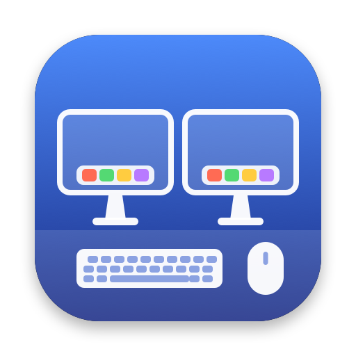

<p align="center"></p>

# DeskKit

**Small tools for a Mac at a desk: external displays, a mouse and a keyboard.** Free and open source.

- **A Dock on every display.** macOS shows the Dock on one display at a time. DeskKit puts a working
  copy of it on all the others, the way the Windows taskbar can show on every monitor.
- **A window picker.** Click an app that has several windows, in the Dock or in one of DeskKit's
  copies, and pick the window you want from small previews. An X on each preview closes that window.
- **Reverse the mouse wheel.** Keep natural scrolling on the trackpad while a mouse wheel scrolls the
  traditional way.

Each one can be turned on or off from DeskKit's menu bar icon, whose menu also shows CPU and memory use,
temperatures, and whether macOS is slowing your Mac down to cool it. DeskKit runs on macOS 12 Monterey and
later, on Apple silicon and Intel Macs. At rest it uses well under 0.1% of one CPU core and about
30 MB of memory, and moving the pointer around anywhere but its Docks costs it nothing.

## A Dock on every display

- **One copy per display**, except the one the real Dock is on. With *Displays have separate Spaces*
  turned on, the Dock jumps to whichever display you push the pointer against; DeskKit notices within
  a third of a second, fades out the copy where the Dock landed and fades one in where it left.
  Displays you plug in or unplug get or lose a copy straight away.
- **Mirrors your Dock's settings**: pinned apps, running apps, folders, files, web links, spacers and
  the Trash, in the Dock's order; icon size (shrinking as far as the Dock does when it doesn't fit its
  display); position (bottom, left or right); magnification and its size; running-app dots; badges such
  as unread counts; *Show suggested and recent apps*; *Show only open apps*; dimmed hidden apps; launch
  animations. Change something in the Dock and the copies follow within two seconds, and a resized
  Dock straight away.
- **Works like the Dock**: click to open an app or bring it forward (it reopens a window if it has
  none), open folders, files and the Trash; right-click or Control-click for Hide/Show, Show in
  Finder and Quit (hold Option for Force Quit); drop files on an app to open them with it, or on the
  Trash to move them there (for a protected item, such as an app installed for all users, Finder asks
  for your password, as with the Dock's Trash). Launching apps bounce until they've finished launching.
- **Looks like the Dock**: Liquid Glass on macOS 26 and later (tuned against the real Dock), vibrancy
  on earlier versions, with name labels, magnification and light and dark mode.
- **Hiding**, under *Dock Options* in the menu (or right-click an empty part of a copy):
  - *Hide When the Dock Hides* (default): follows the Dock's own auto-hide setting.
  - *Never Hide*.
  - *Hide When a Window Covers It*: makes room for windows underneath.
  - *Always Hide*.

  A hidden copy slides back in when the pointer touches that display's Dock edge. Whatever the
  setting, a display showing a full-screen app has no copy, as it has no Dock. When the app in front
  hides the Dock, as games in a borderless full-screen window do, the copies hide too, and when it
  asks for the Dock to hide until the pointer reaches it, so do they.
- **Keeps windows clear of the copies.** On the display with the real Dock, a zoomed window stops at
  the Dock. DeskKit does the same beside its copies: a window that's zoomed, filled, tiled or opened
  against one is moved to start beside it, and zooming it again still restores its old size. A window
  you drag underneath yourself is left there, as it would be with the Dock. macOS gives apps no way to
  reserve screen space, so DeskKit resizes those windows itself, right after macOS's zoom animation.

## Window picker

- Click an app that has two or more windows, in the real Dock or one of DeskKit's copies, and a small
  panel opens beside its icon with a preview of each window, minimized ones included (and, with
  Screen Recording access, ones on other Spaces, full-screen ones included).
- Click a preview (or use the arrow keys and Return) to bring just that window forward. A minimized
  window is restored; for one on another Space (a full-screen one, say), macOS switches there.
- Hover a preview and click its **X** (or press ⌘W) to close that window, even one on another Space.
  The picker stays open for the rest. If the app asks whether to save first, that window comes
  forward so you can answer.
- Esc, a click anywhere else, or clicking the icon again closes the picker.
- Everything else reaches the Dock as before: apps with one window open as usual, and a click with a
  modifier key, a drag (to rearrange icons) or a press and hold (for the Dock's menu) isn't caught.

## Reverse mouse wheel

Trackpads and the Magic Mouse send continuous scrolling and mouse wheels send notched steps, so
DeskKit reverses only the notched ones: natural scrolling on the trackpad, traditional scrolling on the
wheel. It's off until you turn on *Reverse Mouse Wheel* in the menu.

## System stats

The top of DeskKit's menu (from its menu bar icon, or a right-click on an empty part of a Dock copy)
shows how hard your Mac is working, read again every second while the menu is open:

- **CPU**: how busy all the cores are together.
- **Memory**: the share in use, counted like Activity Monitor's *Memory Used* (app memory, wired and
  compressed); hover it for gigabytes. The bar turns yellow or red when macOS reports memory pressure.
- **Temperature**: the average of the CPU's and the GPU's sensors, in your region's unit.
- **Throttling**: whether macOS is slowing your Mac down to cool it, from the thermal pressure it
  reports (the levels `powermetrics` shows): *None* at nominal pressure, *Not yet* at moderate, and
  *Yes* from heavy on.

Nothing is read while the menu is closed, and none of it needs a permission.

## Permissions

| Permission | Used for | Without it |
| --- | --- | --- |
| **Accessibility** (called *Device Control and Data Access* in macOS 27) | the window picker, reversing the mouse wheel, keeping windows clear of the copies | those three are off; the copies of the Dock still work |
| **Screen Recording** (*Screen & System Audio Recording* in macOS 15 and later) | window previews in the picker | the picker shows the app's icon instead |
| **Automation** (to control Finder; asked the first time it's needed) | moving protected items you drop on a copy's Trash, with your password | those items stay where they are |

DeskKit explains and asks for these on its first run, and its menu shows what's missing. Recent
versions of macOS may now and then ask you to confirm that DeskKit can still record the screen.

## Install

1. Download `DeskKit.zip` from [Releases](../../releases), unzip it and open `DeskKit.app`. It's signed
   with a Developer ID and notarized by Apple, so it opens without warnings.
2. DeskKit offers to move itself to your Applications folder, turns on *Open at Login* the first time
   it runs from there, and adds an icon to the menu bar.
3. When it asks, turn DeskKit on under **System Settings → Privacy & Security → Accessibility**
   (*Device Control and Data Access* in macOS 27), and under *Screen Recording* if you want window
   previews. macOS keeps these when you update DeskKit.

### Install with an AI agent

Paste this into Claude Code, Codex, Antigravity or any agent that can run commands on your Mac:

```text
Install DeskKit on this Mac. It's a free, open-source menu bar app
(https://github.com/christopherquenneville/DeskKit): a Dock on every display, a window picker
and mouse wheel reversal.

1. Download https://github.com/christopherquenneville/DeskKit/releases/latest/download/DeskKit.zip
   into a new empty temporary folder, and unzip it there with: ditto -x -k DeskKit.zip .
2. Check it before installing. Both commands must succeed, and spctl must report
   "source=Notarized Developer ID" and
   "origin=Developer ID Application: Christopher Quenneville Barbeau (QW9M3FTB2B)":
     codesign --verify --deep --strict DeskKit.app
     spctl --assess --type execute -vv DeskKit.app
   If either check fails, stop and tell me.
3. If DeskKit is running, quit it (pkill -x DeskKit). Move any older /Applications/DeskKit.app
   to the Trash, then move the new DeskKit.app into /Applications.
4. Open it: open /Applications/DeskKit.app
5. Tell me to switch DeskKit on in System Settings → Privacy & Security → Accessibility
   ("Device Control and Data Access" on macOS 27), and under "Screen & System Audio Recording"
   for window previews. Don't change privacy settings yourself; those switches are mine.
```

### Updates

A minute after it starts and then once a day, DeskKit asks GitHub for its latest release (an
anonymous request to `api.github.com`; nothing about you or your Mac is sent). When there's a newer
version it offers to install it, and *Check for Updates…* in its menu checks right away. An update
is installed only if it's signed by the same developer as the copy you have and notarized by Apple,
and DeskKit restarts into it with its settings and permissions. Untick *Check for updates
automatically* in the update window to stop the daily check.

### Build it yourself

You need Apple's command line tools (`xcode-select --install`); there's no Xcode project.

```bash
./build.sh
```

It compiles a universal binary with `swiftc`, makes `DeskKit.app` and installs it in `/Applications`
(`./build.sh --no-install` only builds it into `build/`). With a *Developer ID Application* certificate
in your keychain the app is signed with it; otherwise it's signed ad hoc, and macOS forgets DeskKit's
permissions after each build (remove it from the Accessibility list with **–** and add it back).

`Tests/run.sh` runs the self-tests, and `./release.sh` makes a notarized `build/DeskKit.zip` (it
explains the one-time setup it needs).

## How it works

- **Reading the Dock.** DeskKit reads `com.apple.dock` (the same preferences the Dock keeps) and
  never writes to it: pinning, removing and resizing stay the real Dock's job. The size the Dock
  actually shows comes from the strip it reserves on its display (when it doesn't hide), since a Dock
  too full for its display shrinks its icons without saving that anywhere.
- **Finding the Dock's display.** The display whose visible area is inset on the Dock's edge is the
  one the Dock is on. An auto-hiding Dock leaves no inset, so DeskKit then assumes the main display.
- **Badges** come from LaunchServices. That's private API, looked up at run time; if a future macOS
  removes it, the copies simply show no badges.
- **Each copy** is a non-activating panel at the Dock's window level, sized tightly around it, and
  hidden on a display showing a full-screen app (the window server's Spaces list says which; private
  API, looked up at run time). Clicks pass through its transparent parts. Its icons are
  Core Animation layers showing bitmaps made once, so magnifying only moves and resizes them.
- **Staying light.** DeskKit never watches the pointer across the whole screen. A copy hears about it
  only while the pointer is over it (or over a one-point sensor along the edge while the copy is
  hidden). The Dock's display and settings are checked again when the pointer pushes against a
  display's Dock edge, which is how the Dock moves, when a display's usable area changes, which is how
  a resized Dock shows, and every 2 seconds besides. With a single display, where no copy can
  show, DeskKit stops following the Dock and other apps' windows altogether. If macOS ever starts
  sending DeskKit every move of the pointer anyway (one copy of DeskKit was found getting them
  after a day of use), DeskKit notices within a few seconds of mouse movement, builds its windows
  again, and, if the moves keep coming, restarts itself.
- **Keeping windows clear.** DeskKit watches windows being created, moved and resized through the
  Accessibility API, and once a zoom or tile has settled it pulls the window's edge out of the strip
  the Dock would reserve (the copy plus its gap from the screen edge).
- **The window picker** watches mouse presses with an event tap. A plain click on a running app's icon
  in the Dock (found through the Accessibility API) is held back if the app has two or more windows,
  and the picker opens instead; anything else is passed on untouched. Windows come from the
  Accessibility API, plus the window server for windows on other Spaces, which Accessibility leaves
  out; to bring those forward or close them, DeskKit asks the app for its elements by number until
  it finds them, as AltTab does. Previews come from ScreenCaptureKit, except for windows on other
  Spaces, which it can't capture: those come from the window server's own capture call. Both are
  private API, looked up at run time; without them, those windows show the app's icon and can't be
  closed from the picker. The window you pick comes forward on its own, as if you'd clicked it,
  rather than with every window of its app: that takes the window server's private calls (the ones
  AltTab and yabai use), looked up at run time; without them, the whole app comes forward.
- **Reversing the mouse wheel** is another event tap, which flips scroll events that aren't continuous.
- **System stats** come from the kernel's CPU and memory counters (the ones `top` reads), the thermal
  pressure level macOS posts for apps (`com.apple.system.thermalpressurelevel`; `ProcessInfo.thermalState`
  sums it up in four steps and calls both moderate and heavy "fair"), and, for temperatures, the SMC,
  the chip that runs the fans, through IOKit. The SMC's sensors aren't documented: on Apple silicon
  DeskKit averages the ones named `Tp…` (CPU) and `Tg…` (GPU), as Stats and macmon do, and on Intel
  Macs it reads the CPU and GPU die sensors. If it finds none, the menu leaves temperatures out.

## Differences from the real Dock

- Folders open in Finder instead of fanning out as stacks, and show the folder's icon rather than
  its newest items.
- No minimized windows, no live icons drawn by apps (Calendar's date, Activity Monitor's graphs),
  and no bounce when an app asks for attention.
- App menus are shorter: no window list or *Options* submenu.
- You can't drag items to rearrange or remove them; do that in the real Dock.

## License

MIT. See [LICENSE](LICENSE).
